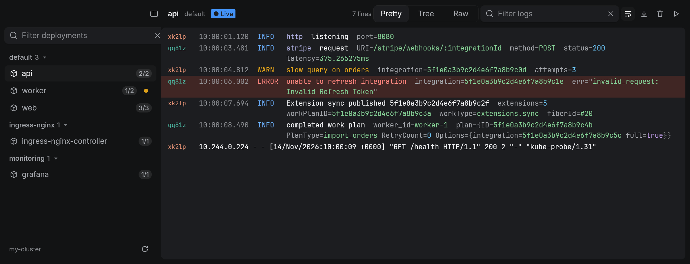
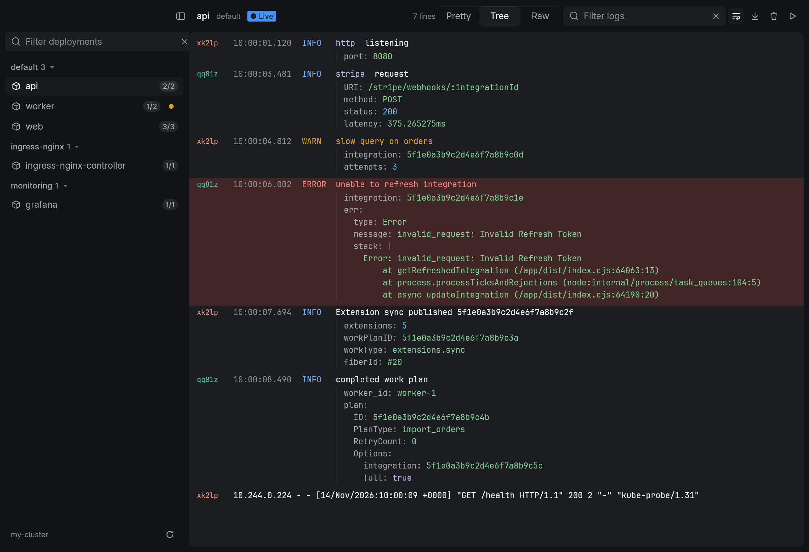

# klog-ui

A native, GPU-rendered live log viewer for Kubernetes. Deployments are listed in a sidebar;
pick one and the logs of all its pods stream into the main pane. JSON logs are parsed and shown
as readable, coloured rows or as an indented tree.

Built with [Rune](https://github.com/anomalyco/rune), Anomaly's Rust UI framework, and its
component kit `rune-kit`.





## Features

- **Deployments sidebar**: every deployment in the cluster, grouped by namespace in foldable
  sections, with ready/desired replica counts and a dot on deployments that aren't fully ready.
  Filter by name; the list refreshes every 15 s (or with the refresh button). The footer shows
  the current kubectl context.
- **Live logs**: follows every pod and container of the selected deployment
  (`kubectl logs --follow --all-pods --all-containers`), starting from the last 500 lines of
  each pod. The view sticks to the bottom while new lines arrive and stops following when you
  scroll up. Rows are virtualised; the newest 20,000 lines are kept.
- **Per-pod colours**: each line is tagged with its pod's unique suffix (`xk2lp`), coloured per
  pod; hover it for the full `pod/container` name.
- **Structured (JSON) logs**, in three formats from the toolbar:
  - **Pretty** (default): `time LEVEL logger message key=value …` on one line, values coloured by
    type, nested objects as `{key=value …}`, error objects as their message.
  - **Tree**: the message, then every field as an indented tree; multi-line strings such as
    stack traces as indented blocks.
  - **Raw**: exactly what the pod wrote.

  Plain-text lines show as they are, with warning and error lines coloured by keyword.
- **Filter**: case-insensitive substring match over the raw line and pod name.
- **Toolbar**: stream status, line count, wrap on/off, jump to latest, clear, stop/reconnect.
- **Sidebar toggle**: ⇧⌘B (Ctrl+Shift+B on Linux and Windows).

### Supported JSON dialects

Lines are normalised into time, level, logger, message and fields:

| Logger | Recognised |
| --- | --- |
| zap (Go) | `ts`, `level`, `logger`, `msg` |
| slog (Go) | `time` (nanoseconds trimmed to ms), `level`, `msg` |
| pino (Node) | `time` (epoch ms, shown in UTC), numeric `level` (40 → WARN, 50 → ERROR), `msg`, `err.{message,stack}`; `pid` and `hostname` hidden |
| Effect (TS) | `message` as a string or an array (strings form the message, objects become fields), `level`, `timestamp`, `annotations` hoisted to fields, `cause` as the message when there is none |

Empty objects and arrays and `null` fields are hidden in Pretty and Tree; Raw keeps them.

## Requirements

- `kubectl` on `PATH`, configured for the cluster you want (the current context is used, along
  with any exec auth plugins such as `doctl`). Set `KUBECTL` to use another binary. Fetching
  logs from all pods of a deployment needs kubectl 1.30 or newer (`--all-pods`).
- Rust. `rust-toolchain.toml` pins the toolchain Rune uses; rustup installs it on first build.
- Linux: `libxkbcommon` and `wayland` development packages (Arch: `pacman -S libxkbcommon
  wayland`; Debian/Ubuntu: `apt-get install libxkbcommon-dev libwayland-dev`).

## Run

```sh
cargo run --release
```

## Develop

```sh
cargo test                                         # unit tests (parsing, buffer, levels)
cargo test -- --ignored live_cluster --nocapture   # talks to the real cluster via kubectl
cargo clippy --all-targets
```

Debug builds can render headless, with sample data and without touching the cluster:

```sh
./target/debug/klog-ui --snap out.png --scene demo          # Pretty
./target/debug/klog-ui --snap out.png --scene demo-tree     # Tree
./target/debug/klog-ui --snap out.png --scene demo --theme light --size 1300x700
```

### Layout

| File | What it holds |
| --- | --- |
| `src/main.rs` | App wiring, key handling, demo scenes |
| `src/app.rs` | State, stream switching, periodic refresh |
| `src/kube.rs` | `kubectl` processes on worker threads, and the inbox they feed the UI through |
| `src/logs.rs` | Bounded log buffer, filtering, per-pod colour slots, plain-text level detection |
| `src/structured.rs` | JSON parsing and normalisation, and the styled inline and tree text (no UI code) |
| `src/view.rs` | Sidebar, toolbar and the virtualised log list |

Rune is pre-release, so `Cargo.toml` pins a `dev` revision and patches the same crates Rune
patches. When bumping it, use one revision everywhere and copy any new `[patch.crates-io]`
entries from Rune's root `Cargo.toml`.
