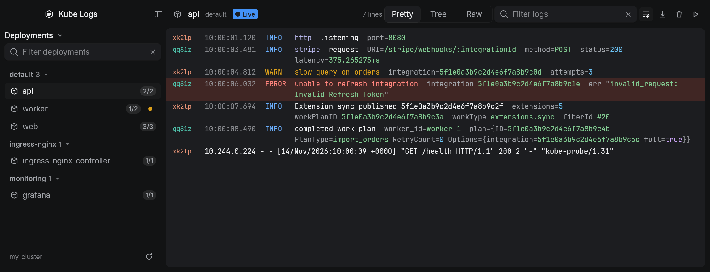
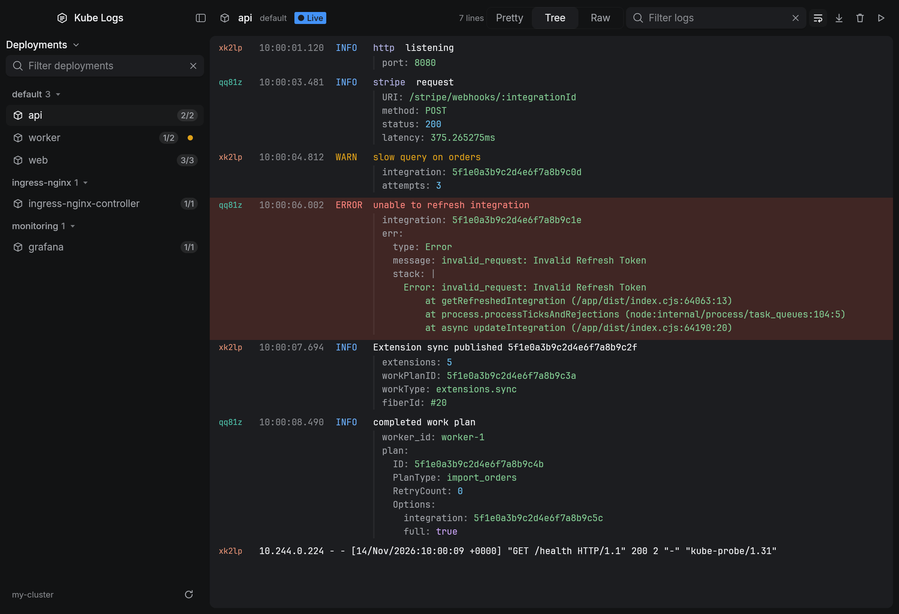
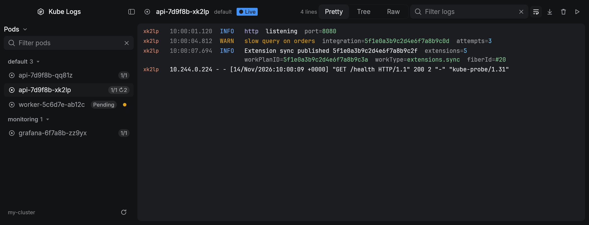
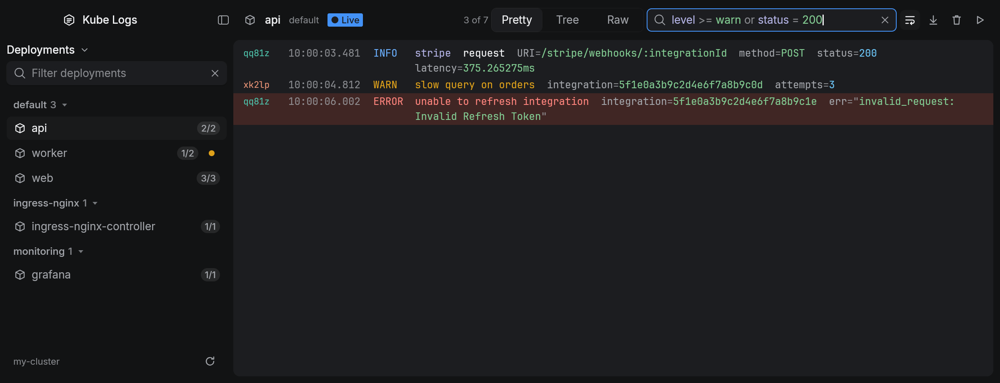

# klog-ui

A native, GPU-rendered live log viewer for Kubernetes. Deployments, pods, services and other
workloads are listed in a sidebar; pick one and the logs of all its pods stream into the main pane. JSON logs are parsed and shown
as readable, coloured rows or as an indented tree.

Built with [Rune](https://github.com/anomalyco/rune), Anomaly's Rust UI framework, and its
component kit `rune-kit`.







## Features

- **Workloads sidebar**: a picker at the top switches what it lists — Deployments (default),
  Pods, Services, StatefulSets, DaemonSets or Jobs. Everything of that kind in the cluster,
  grouped by namespace in foldable sections, with a status badge (ready/desired, a pod's ready
  containers and restarts or its phase, a service's type, a job's completions) and a dot on
  those that need attention. Filter by name; the list refreshes every 15 s (or with the refresh
  button). Switching kinds keeps the current stream. The footer shows the current kubectl
  context.
- **Live logs**: follows every pod and container behind the selected workload
  (`kubectl logs --follow --all-pods --all-containers`), starting from the last 500 lines of
  each pod. The view sticks to the bottom while new lines arrive and stops following when you
  scroll up. Rows are virtualised; the newest 20,000 lines are kept.
- **Per-pod colours**: each line is tagged with its pod's unique suffix (`xk2lp`), coloured per
  pod; hover it for the full `pod/container` name.
- **Structured (JSON) logs**, in three formats from the toolbar:
  - **Pretty** (default): `time LEVEL logger message key=value …` on one line, values coloured by
    type, nested objects as `{key=value …}`, error objects as their message.
  - **Tree**: the message, then every field as an indented tree; multi-line strings such as
    stack traces as indented blocks.
  - **Raw**: exactly what the pod wrote.

  Plain-text lines show as they are, with warning and error lines coloured by keyword.
- **Filter** with a small query language: words, phrases, `field = value`, comparisons and
  `and`/`or`/`not`, coloured as you type. See [Filtering logs](#filtering-logs).
- **Copy any line raw**: from the copy button on hover or the right-click menu, in every format.
  See [Copying lines](#copying-lines).
- **Toolbar**: stream status, line count, wrap on/off, jump to latest, clear, stop/reconnect.
- **Sidebar toggle**: ⇧⌘B (Ctrl+Shift+B on Linux and Windows).

## Filtering logs

The box at the top right filters the log as you type. A word matches anywhere in the line; a
`key op value` comparison looks at one field of a structured (JSON) line.



### Examples

```text
timeout                                   lines containing "timeout" (any case)
"connection reset"                        a phrase, quoted with ' or "
integration = '5f1e0a3b9c2d4e6f7a8b9c0d'  a field equals a value
integration = 5f1e*                       ... with * as a wildcard
integration = *                           lines that have the field at all
err.message ~ token                       a nested field contains a value
status >= 500                             numeric comparison
level >= warn                             warnings and worse
method != GET and msg !~ health           negations
pod ~ xk2lp                               lines from one pod
time >= 10:00:00 time < 10:05:00          a time window (time of day, as shown)
(level = error or status >= 500) -health  grouping and exclusion
```

### Operators

| Operator | Meaning |
| --- | --- |
| `=` or `==` | equals, ignoring case; `*` matches any run of characters |
| `!=` | doesn't equal (true when the field is missing) |
| `~` or `:` | contains, ignoring case |
| `!~` | doesn't contain (true when the field is missing) |
| `>` `>=` `<` `<=` | compares numbers as numbers, levels by severity, anything else as text |

Spaces around operators are optional (`status>=500` works). Values with spaces or brackets need
quotes; otherwise a value runs to the next space, so `time > 10:00:01` and `uri = /a/:id` need
none.

### Keys

| Key | Refers to |
| --- | --- |
| `msg`, `message` | the message (the whole line for plain text) |
| `level`, `lvl`, `severity` | the level: `trace` < `debug` < `info` < `warn` < `error` < `fatal`; plain-text lines get one from their keywords |
| `logger` | the logger's name |
| `time`, `ts` | the time of day, `HH:MM:SS.mmm` |
| `pod` | `pod-name/container` |
| `raw`, `line` | the line as the pod wrote it |
| anything else | a JSON field: `integration`, `err.message` (dots go into nested objects), `tags.0` (array items) |

Keys ignore case, and a field named with a dot (`log.origin`) is found before a nested path.
Fields are matched after normalisation (see [Supported JSON dialects](#supported-json-dialects)),
so Effect's `annotations` are top-level keys, and pino's `pid` and `hostname` aren't searchable
by key (a plain word still finds them).

### Combining

Terms next to each other must all match (`and` is optional). `or` gives alternatives, and binds
looser than `and`: `a b or c` is `(a and b) or c`. `not`, `-` or `!` before a term negates it,
and parentheses group. `and`, `or` and `not` are case-insensitive; quote them to search for the
words themselves.

### While typing

The query is coloured as you type: keys, operators, values and keywords each get a colour. While
it's incomplete (an open quote, an operator with no value, an unclosed parenthesis) the box turns
red, hovering it says what's missing, and the last complete query keeps filtering, so the list
doesn't empty out mid-word. Hover the empty box for a syntax summary. The × clears it.

## Copying lines

- **Hover** a line: a copy button appears at its right end and shows a check once copied.
- **Right-click** a line:
  - **Copy line**: the line exactly as the pod wrote it.
  - **Copy message**: just the message of a JSON line.
  - **Show only this pod**: sets the filter to `pod ~ '<pod>'`.

Copying takes the raw line in every format (Pretty, Tree or Raw), without the `[pod/…]` prefix
kubectl adds. With line wrapping off, long lines can push the copy button out of view; the
right-click menu works anywhere on the line.

## Supported JSON dialects

Lines are normalised into time, level, logger, message and fields:

| Logger | Recognised |
| --- | --- |
| zap (Go) | `ts`, `level`, `logger`, `msg` |
| slog (Go) | `time` (nanoseconds trimmed to ms), `level`, `msg` |
| pino (Node) | `time` (epoch ms, shown in UTC), numeric `level` (40 → WARN, 50 → ERROR), `msg`, `err.{message,stack}`; `pid` and `hostname` hidden |
| Effect (TS) | `message` as a string or an array (strings form the message, objects become fields), `level`, `timestamp`, `annotations` hoisted to fields, `cause` as the message when there is none |

Empty objects and arrays and `null` fields are hidden in Pretty and Tree; Raw keeps them.

## Requirements

- `kubectl` on `PATH`, configured for the cluster you want (the current context is used, along
  with any exec auth plugins such as `doctl`). Set `KUBECTL` to use another binary. Fetching
  logs from all pods of a deployment needs kubectl 1.30 or newer (`--all-pods`).
- Rust. `rust-toolchain.toml` pins the toolchain Rune uses; rustup installs it on first build.
- Linux: `libxkbcommon` and `wayland` development packages (Arch: `pacman -S libxkbcommon
  wayland`; Debian/Ubuntu: `apt-get install libxkbcommon-dev libwayland-dev`).

## Run

```sh
cargo run --release
```

## Develop

```sh
cargo test                                         # unit tests (parsing, buffer, levels)
cargo test -- --ignored live_cluster --nocapture   # talks to the real cluster via kubectl
cargo clippy --all-targets
```

Debug builds can render headless, with sample data and without touching the cluster:

```sh
./target/debug/klog-ui --snap out.png --scene demo          # Pretty
./target/debug/klog-ui --snap out.png --scene demo-tree     # Tree
./target/debug/klog-ui --snap out.png --scene demo-pods     # Pods in the sidebar
./target/debug/klog-ui --snap out.png --scene demo --theme light --size 1300x700
```

### Layout

| File | What it holds |
| --- | --- |
| `src/main.rs` | App wiring, key handling, demo scenes |
| `src/app.rs` | State, stream switching, periodic refresh |
| `src/kube.rs` | `kubectl` processes on worker threads, and the inbox they feed the UI through |
| `src/logs.rs` | Bounded log buffer, filtering, per-pod colour slots, plain-text level detection |
| `src/query.rs` | The filter's query language: tokens, parser, matching, highlighting |
| `src/structured.rs` | JSON parsing and normalisation, and the styled inline and tree text (no UI code) |
| `src/view.rs` | Sidebar, toolbar and the virtualised log list |

Rune is pre-release, so `Cargo.toml` pins a `dev` revision and patches the same crates Rune
patches. When bumping it, use one revision everywhere and copy any new `[patch.crates-io]`
entries from Rune's root `Cargo.toml`.
